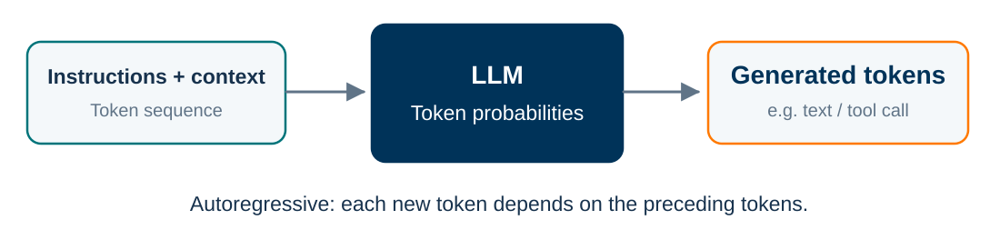
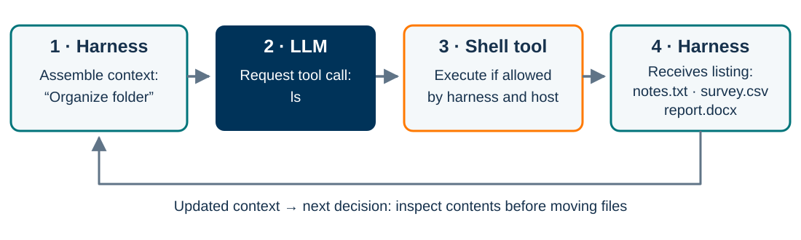

<!-- _class: lead -->
<!-- _paginate: false -->
<!-- _header: "" -->
<!-- _footer: "" -->

# From LLMs to AI Agents

## What separates generating an answer from taking action?

**Block 1 · 10:45–12:30**

---

# What does an LLM actually do?

An LLM predicts the **next token** from its input context. It cannot access your files or execute commands on its own.

**Same request:** “Organize this project folder.”

- **LLM alone:** suggests a folder structure and commands.
- **Agent:** can inspect files and execute *permitted* changes via tools.

---

<!-- _class: compact -->

# What turns an LLM into an agent?

- **LLM:** proposes the next step or a structured tool call.
- **Agent harness:** manages context, invokes tools, and enforces permissions.
- **Tools:** read or change the environment; results are fed back to the model.

**Key distinction:** The harness executes actions; the model generates outputs.

---

<!-- _class: compact -->

# The agent loop: a concrete tool call

**Model requests:** `ls 01_dateichaos/arbeitsordner/`  
**Harness executes → tool returns:** `notes.txt  survey.csv  report.docx`  
**Next model call:** “I should inspect the contents before moving files.”

**Repeat** until the task is complete, blocked, or stopped.

---

<!-- _class: exercise -->

# Exercise 1 · Organize the Chaos

**11:00–11:20 · Setup**

- Start Codespaces; select an agent and configure your model provider.
- **Never put API keys in tracked files or commits.**

**11:20–12:00 · Group work**

> “Analyze `01_dateichaos/arbeitsordner/` and organize it so a new team member can find their way around.”

**Observe:** Which files does the agent read? Which tools does it use?

**Safety:** Review moves, overwrites, and deletions before approving them.

**12:00–12:15 · Discuss and compare results**

---

# What is a context window?

- A **limited token budget for a single model call** (model-dependent).
- Includes the instructions, messages, and tool outputs **actually supplied**.
- Does **not** automatically include your entire disk or serve as permanent memory.

---

<!-- _class: token -->

# Context limits are not session usage

- **Per call:** Input and generated output must fit the model's applicable limits.
- **Across a session:** Usage adds up over *all* calls, including repeated history.
- **Costs:** Input/output rates differ; caching can reduce charges, and compaction can shorten future inputs.

---

<!-- _class: section -->

# What should an agent know?

## Relevant context beats maximum context.

**Questions for Block 2:**

- Which information actually helps the agent?
- Which instructions and constraints must we state explicitly?
- How do we check the result?

**Next:** Context Engineering · `AGENTS.md` · Agent Contracts
