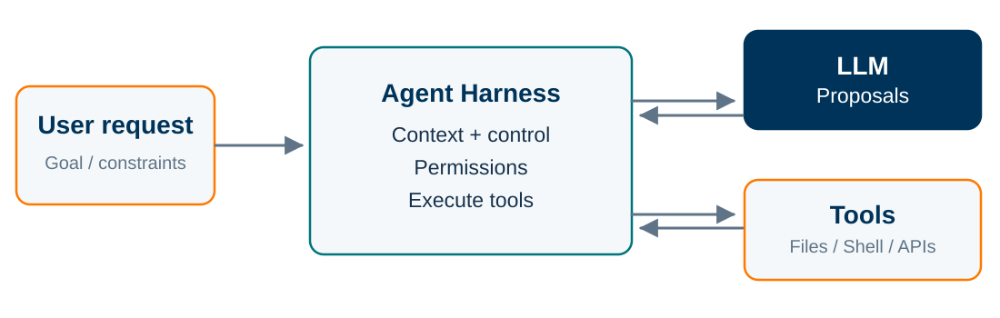
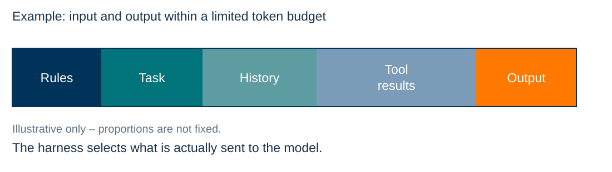
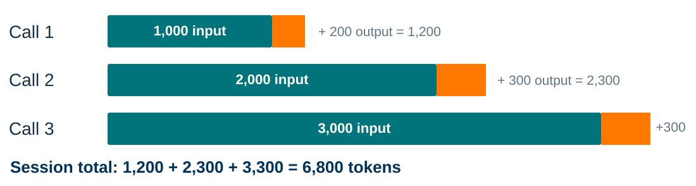

<!-- _class: lead -->
<!-- _paginate: false -->
<!-- _header: "" -->
<!-- _footer: "" -->

# From LLMs to AI Agents

## What separates generating an answer from taking action?

**Block 1 · 10:45–12:30**

Objective: Understand how agents use tools and evaluate their actions.

---

# What does an LLM actually do?

An LLM predicts the **next token** from its input context. It cannot access your files or execute commands on its own.

**Same request:** “Organize this project folder.”

- **LLM alone:** suggests a folder structure and commands.
- **Agent:** can inspect files and execute *permitted* changes via tools.

---

<!-- _class: compact -->

# What turns an LLM into an agent?

- **LLM:** proposes the next step or a structured tool call.
- **Agent harness** (e.g. OpenCode or Codex): manages context, invokes tools, and handles approvals.
- **Tools:** read or change the environment; results are fed back to the model.

**Host environment:** Enforces access restrictions (e.g. filesystem permissions or isolation).

---

<!-- _class: compact -->

# The agent loop: a concrete tool call

The harness assembles the request and sends it to the LLM. The LLM requests `ls`; the harness invokes the shell if allowed. The listing becomes context for the next model call.

**Repeat** until the task is complete, blocked, or stopped.

---

<!-- _class: exercise -->

# Exercise 1 · Organize the Chaos

**11:00–11:20 · Setup**

- Start Codespaces; choose an agent harness and configure model access.
- **Never put API keys in tracked files or commits.**

**11:20–12:00 · Group work**

> “Analyze `01_file_organization/working/` and organize it so a new team member can find their way around.”

**Observe and discuss:**
- Did it inspect file contents or rely on filenames?
- Which decisions did it make without asking?
- Verify file preservation after the run using `01_file_organization/verify.py`.

**Safety:** Review moves, overwrites, and deletions; use fictional files only.

**12:00–12:15 · Discuss and compare results**

[Exercise instructions](https://github.com/st0nedB/agentic-ai-workshop/blob/main/01_file_organization/README.md)

---

# Why did the agent read some files but not others?

The model can only work with information supplied to it in its current call.

The **context window** is the model's limited token budget for a single call. It is not the entire disk or permanent memory.

---

<!-- _class: token -->

# Context limits are not session usage

- **Context window:** limits an individual model call.
- **Total token usage:** accumulates across all calls, including repeated context.

---

<!-- _class: section -->

# What should an agent know?

## Relevant context beats maximum context.

**Questions for Block 2:**

- Which information actually helps the agent?
- Which instructions and constraints must we state explicitly?
- How do we check the result?

**12:15–12:30 · Questions, discussion and troubleshooting**

**Next:** Context Engineering · `AGENTS.md` · Agent Contracts
