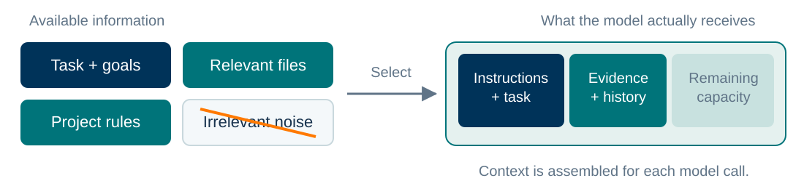
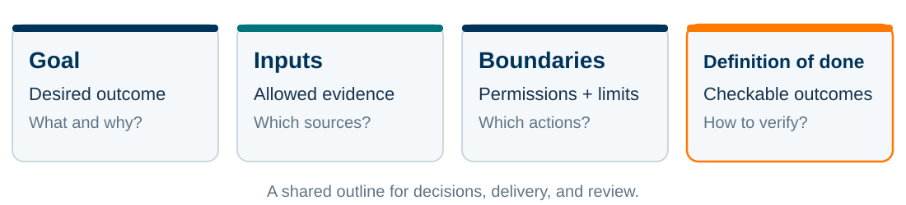
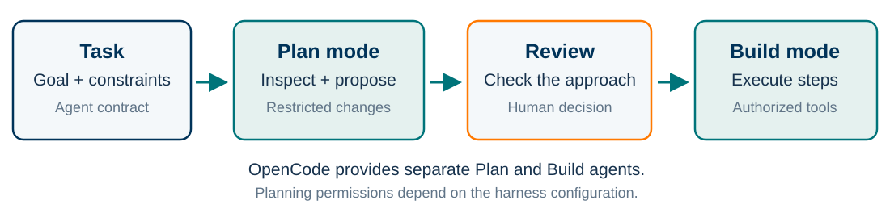
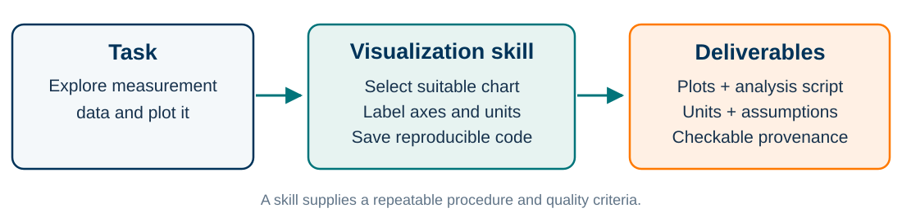
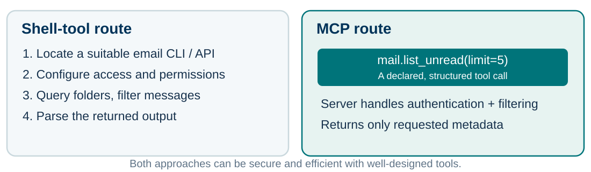
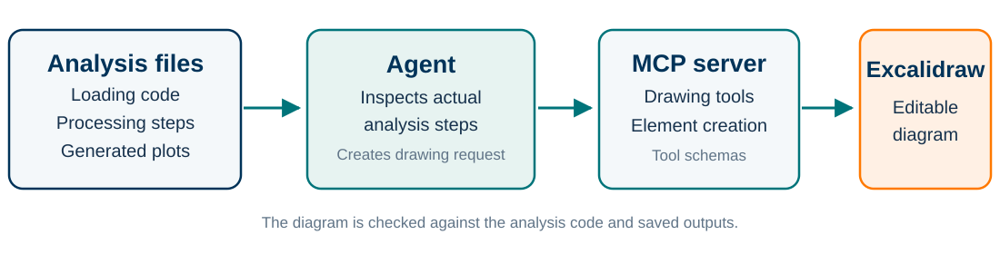
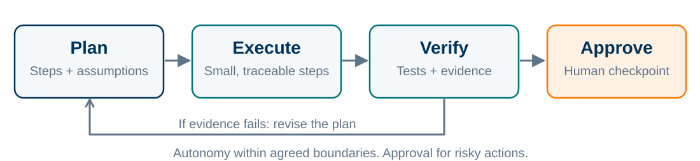

<!-- _class: lead -->
<!-- _paginate: false -->
<!-- _header: "" -->
<!-- _footer: "" -->

# Directing AI Agents

## Context, planning, reusable skills, and MCP

**Block 2 · 13:00–15:00**

Objective: Direct agents with context, plans, skills and external tools.

---

<!-- _class: compact -->

# Why context matters

In Exercise 1, the agent had to decide which files to inspect.

**Minimal prompt:** Analyze this measurement dataset.

**With relevant context:** Analyze the supplied measurement file using the documented recording parameters, data structure, and physical units.

Without that context, the agent must discover the information, ask for it, or make assumptions.

---

<!-- _class: compact -->

# Build the context deliberately



- Supply the relevant measurements, task requirements, and prior decisions.
- Ask the agent to distinguish observed evidence from assumptions.
- The harness assembles the context for each model call.

**Question:** What does the agent need to know to analyze unfamiliar data?

---

<!-- _class: compact -->

# Define success with an Agent Contract



> “Inspect the provided measurement data. Produce two interpretable plots and the code that generated them. Preserve the input files. Document units, assumptions, and checks.”

**Goal · Inputs · Boundaries · Definition of done**

---

<!-- _class: compact -->

# Project instructions can persist

An instruction file gives the agent repeatable project guidance.

```markdown
# Project guidance
- Treat measurement files as read-only.
- Write scripts and plots to results/.
- Label every axis and state the units.
- Document assumptions in RESULTS.md.
```

**Codex and OpenCode:** `AGENTS.md`

Each harness has its own conventions for loading project instructions.

---

<!-- _class: compact -->

# Plan, review, then execute



- **Planning:** Inspect the dataset and propose analysis steps.
- **Review:** Check the assumptions and expected plots.
- **Execution:** Run the approved analysis and inspect the outputs.

OpenCode provides Plan and Build agents. Codex also supports planning. Actual tool permissions depend on the harness.

---

<!-- _class: compact -->

# Skills make procedures reusable



A **Data Visualization Skill** can guide plot selection, labeling, uncertainty reporting, and reproducibility.

The agent uses its usual coding tools to carry out the procedure.

---

<!-- _class: compact -->

# What does a skill look like?

```text
visualization/
├── SKILL.md
└── references/   (optional)
```

Example excerpt from `SKILL.md`:

```markdown
- Inspect the data structure and identify units.
- Choose plots appropriate to the measured quantity.
- Label axes and save the code used to generate plots.
```

A compatible harness discovers and loads the instructions when needed. Skills can also contain scripts and reference material. Inspect them before use.

---

# Three complementary ways to direct an agent

| Mechanism | Purpose | Scope |
|:--|:--|:--|
| Agent Contract | What must be achieved? | Individual task |
| Project instructions | Which rules generally apply? | Project |
| Skill | How should a recurring task be performed? | Reusable procedure |

All three supply context; they do not create new model capabilities.

---

<!-- _class: compact -->

# The measurement file

**Input:** `channel.h5` and `target.h5` in `02_data_analysis/dataset/` (Git LFS).

- ISAC UAV measurements; choose your own analysis objective.
- The example video in `dataset/.example/` is optional inspiration.
- HDF5 stores arrays and metadata in a hierarchical structure.
- Inspect dataset names, shapes, attributes and available documentation before interpreting values.
- Choose plots appropriate to the measured quantities and their documented units.

**Do not invent missing metadata or assume the array dimensions.**

---

<!-- _class: exercise -->

# Exercise 2 · Analyze measurement data

**13:25–13:55 · Group work**

1. Inspect the dataset, choose an objective and define an **Agent Contract**.
2. Request a plan without edits; review it before execution.
3. Inspect the [Scientific Visualization Skill](https://github.com/K-Dense-AI/scientific-agent-skills/blob/main/skills/scientific-visualization/SKILL.md). Find out how to use it with your agent and apply it during execution.
4. Save the contract, code, two meaningful labeled visualizations and interpretation in `results/`.

**Verify:** Do the plots match the data and units? Are the processing steps reproducible?

**13:55–14:05 · Share observations and results**

[Exercise instructions](https://github.com/st0nedB/agentic-ai-workshop/blob/main/02_data_analysis/README.md)

---

<!-- _class: compact -->

# How can an agent access external applications?

**Example question:** “Do I have any unread emails?”



A purpose-built CLI or API can expose application capabilities. **Model Context Protocol (MCP)** standardizes how compatible clients discover and invoke tools. Access must still be configured.

---

<!-- _class: compact -->

# Excalidraw through MCP



- The MCP server exposes drawing capabilities to the agent.
- The agent describes elements and relationships through tool calls.
- The generated diagram remains editable in Excalidraw.

**Input:** The actual analysis files and processing steps from Exercise 2.

---

# Tools, Skills, and MCP

| Mechanism | What it provides | Example |
|:--|:--|:--|
| Shell tools | Command execution | `python analyze.py` |
| Agent Skills | Reusable methods and instructions | Data Visualization Skill |
| MCP servers | Discoverable, structured tool interfaces | Excalidraw drawing operations |

MCP tools are still tools; a skill supplies reusable guidance. An agent can combine all three.

**Trust matters:** Inspect third-party skills, scripts and MCP servers before installing them. Keep forwarded ports private.

---

<!-- _class: exercise -->

# Exercise 3 · Draw the actual workflow

**14:20–14:55 · Group work**

1. Find an **Excalidraw MCP server** and connect it to your agent.
2. Inspect the actual Exercise 2 code, even if incomplete.
3. Draw the workflow from **file loading** through **processing** to **visualization**.
4. Compare the diagram with the code and correct missing or invented steps.

**Deliverable:** `results/workflow.excalidraw` and a short source note.

**14:55–15:00 · Compare diagrams**

[Exercise instructions](https://github.com/st0nedB/agentic-ai-workshop/blob/main/02_data_analysis/EXERCISE-3.md)

---

<!-- _class: compact -->

# Verify the workflow against the evidence



- Check whether each diagram step appears in the actual code.
- Confirm the input files and generated outputs.
- Revise the diagram when the evidence does not match.

**Takeaway:** A useful agent workflow is inspectable and reproducible.

---

<!-- _class: section -->

# What can the agent access?

## Next: Containers, sandboxing, and enforced boundaries.

In Block 3, the same task runs with different enforced access restrictions.
