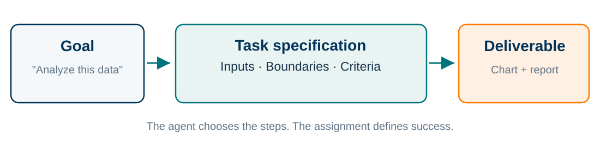
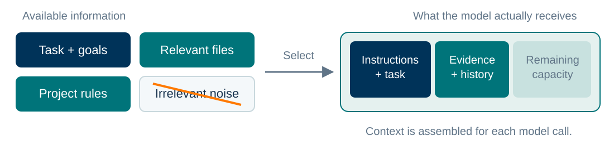
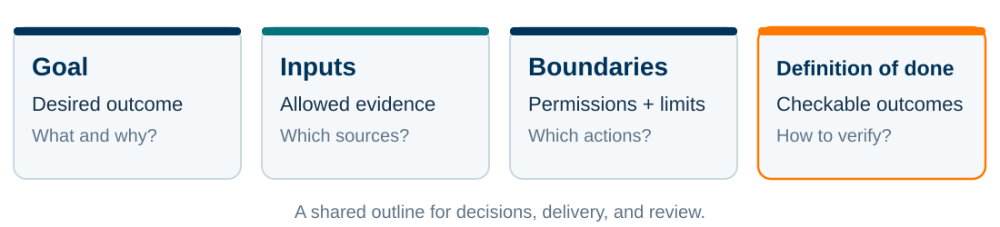
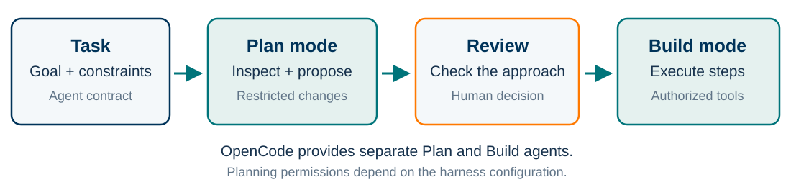
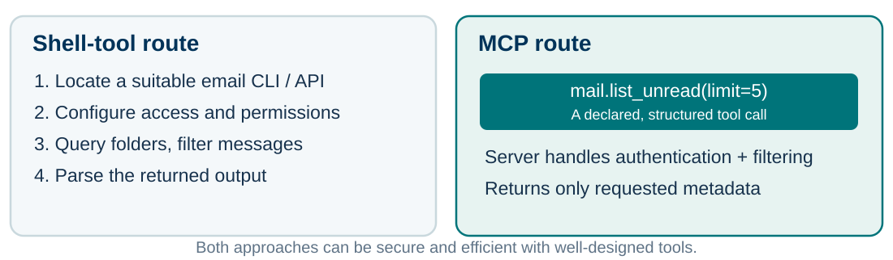
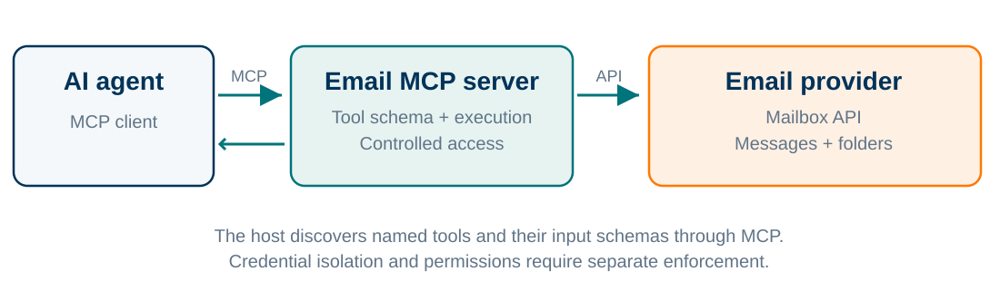
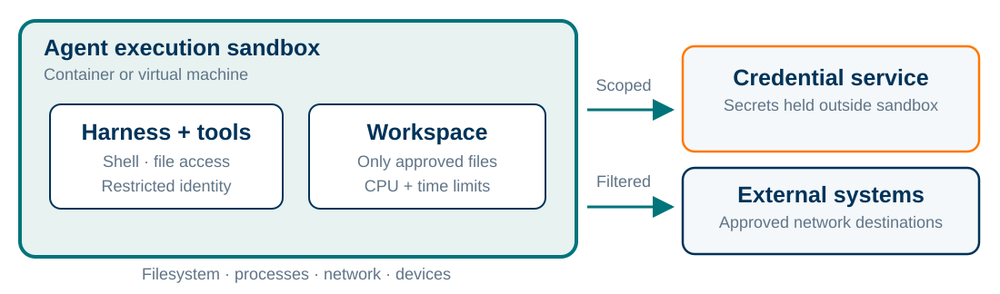
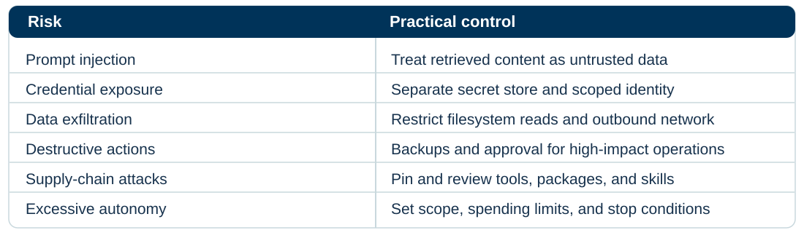
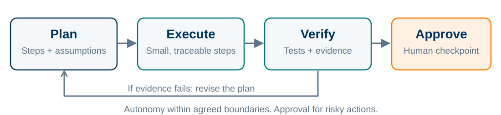

<!-- _class: lead -->
<!-- _paginate: false -->
<!-- _header: "" -->
<!-- _footer: "" -->

# From Prompts to Reliable Workflows

## Give the agent a goal, context, and boundaries.

**Block 2 · 13:00–15:00**
---
# Turn a request into a clear assignment



A useful assignment specifies **what success looks like** while giving the agent freedom to choose suitable steps.

**Question:** Which choices should the agent make? Which must you make?
---
<!-- _class: compact -->

# Build the context deliberately



- Provide **relevant sources, instructions, and earlier decisions**.
- Identify evidence the agent should trust and assumptions it should flag.
- The harness assembles messages and tool results for each model call.

**Goal:** Give the model enough context to act and explain its choices.
---
<!-- _class: compact -->

# Specify the task with an agent contract



> "Inspect the supplied data. Create one chart and a one-page report. Preserve all original files. Include checks and unresolved questions."

**Goal · Inputs · Boundaries · Definition of done**
---
<!-- _class: compact -->

# Project instructions in practice

A project can provide stable guidance through an instruction file:

```markdown
# Project guidance
- Keep source files unchanged.
- Write outputs to results/.
- Cite the source file for every reported value.
- Record assumptions in NOTES.md.
```

**Codex:** `AGENTS.md` · **Claude Code:** `CLAUDE.md`

Other agents follow different conventions. You can also provide instructions directly.
---
<!-- _class: compact -->

# Plan mode: investigate before executing



- **Plan:** Explore the task, identify unknowns, and propose steps.
- **Review:** Check assumptions, permissions, and expected outputs.
- **Build:** Carry out the approved work using available tools.

**The agent contract defines success. Plan mode organizes execution.**
---
<!-- _class: exercise -->

# Exercise 2 · Specify, plan, and compare

**13:15–13:50 · Group work**

1. Try a broad assignment and observe the agent's approach.
2. Write a contract: **goal, inputs, boundaries, definition of done**.
3. Use OpenCode **Plan mode**. Review the suggested steps.
4. Switch to **Build mode**. Evaluate the result against the contract.

**Capture:** The first approach, revised brief, plan, and outcomes.

**Exercise materials:** To be selected separately.

**13:50–14:05 · Group discussion**
---
# How agents acquire capabilities

| Layer | Purpose | Example |
|:--|:--|:--|
| **Shell / built-in tool** | Execute commands or read files | `python analysis.py` |
| **MCP integration** | Discover and call named external tools | `mail.list_unread()` |
| **Agent skill** | Reuse a procedure or domain guidance | Data-quality checklist |

**A practical workflow combines capabilities with repeatable procedures.**
---
<!-- _class: compact -->

# One task, two ways to access email

**Question:** "Do I have any unread messages?"



A purpose-built CLI can be equally concise. MCP makes named tools accessible through a shared protocol.
---
<!-- _class: compact -->

# MCP: a standard interface for agent tools



- An **MCP server** exposes named capabilities to agent applications.
- The protocol defines tool discovery, schemas, and communication.
- Tool implementations control authentication, filtering, and output size.

**Credential isolation requires an enforced boundary outside the agent's control.**
---
<!-- _class: compact -->

# Sandboxing: enforce the boundaries



- Restrict **files, processes, devices, and network access** at runtime.
- Keep credentials **outside the agent-controlled environment**.
- Allow only required operations through a scoped service or tool.
- **Workshop caveat:** Keys stored in the Codespace may be readable by the agent's shell tools.

**Containers limit access to the host. Virtual machines add a separate kernel boundary.**
---
<!-- _class: compact -->

# What can go wrong?



**Enforce the controls in the environment.** Written instructions and approval prompts are additional safeguards.
---
<!-- _class: compact -->

# Plan, execute, and verify



- Agree on a plan before expensive or irreversible operations.
- Verify evidence and intermediate results as work progresses.
- Require approval for overwriting, publishing, or transmitting data.

**Good workflows are inspectable, recoverable, and testable.**
---
<!-- _class: exercise -->

# Exercise 3 · Delegate an investigation

**14:20–14:55 · Group work**

> "Investigate an unfamiliar dataset or project and produce a defensible result."

1. Inventory the inputs and uncertainties.
2. Define the sandbox scope and permitted tools.
3. Review a plan, then execute and verify.
4. Save a useful output and document the checks.

**Exercise materials:** To be selected separately.

**14:55–15:00 · Short discussion**
---
<!-- _class: section -->

# How much can we delegate?

## Clear tasks. Useful tools. Enforced boundaries.

Which capabilities did the agent need? Which controls helped?

**Next:** Reliability, failure modes, and your own use cases.
